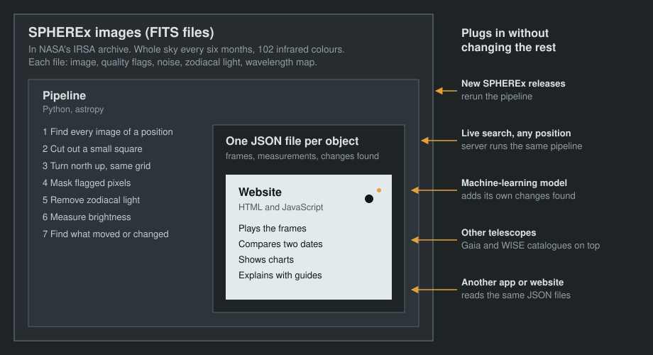

# SPHEREx Explorer

NASA Space Apps Challenge 2026, challenge "Planet X and SPHEREx". Team The K' Oirat, Astana.

Live site: https://alizar52.github.io/spherex-explorer/

## The problem

NASA's SPHEREx telescope photographs the whole sky in 102 infrared colours every six months. Asteroids, comets, nearby stars and brown dwarfs show themselves by shifting between photographs, and variable stars by changing brightness. There are more than a billion objects in the images, too many for scientists to check alone, and the raw files are hard to use for anyone outside astronomy.

## What the tool does

Type a position on the sky (right ascension and declination) or pick an object. The tool finds every SPHEREx image of that spot, lines the images up with north at the top, and plays them in date order like a flip-book. Things that move or change stand out to the eye, and an algorithm marks them as well.

- Time-lapse, blink, side by side, swipe, difference (A minus B) and stack (average, brightest pixel, frame minus average)
- A strip of thumbnails under the image: every photo with its date, detector array and wavelength
- Filter by detector array D1 to D6; brightness over time and a spectrum built from every frame
- Changes found: moving objects, shifted positions (proper motion), brightness changes, single-frame spots, each with a score and plain-language explanation
- Field of view from 3.3′ to 13.1′, quality flags shown on the image, Gaia DR3 and AllWISE overlays, Aladin sky atlas
- Links with coordinates (`?ra=…&dec=…`, `?obj=…`) and embed code
- Guided stories and a tour of the controls for first-time visitors; hover any control for an explanation

## Results on the challenge test targets

Real SPHEREx images, detector D6 (4.4–5.0 µm).

| Target | Frames | Result |
|---|---|---|
| Barnard's Star | 8, Aug 2025 to Mar 2026 | Found automatically as a shifted position: 11.9″ a year, 1.2 px across these frames. Catalogue proper motion 10.4″ a year; the measurement also contains parallax. The core is saturated, so brightness is not reliable. |
| Epsilon Indi B | 8, Apr to Sep 2025 | Found automatically as a shifted position: 4.5″ a year (catalogue 4.7″). Spectrum 16–26 mJy across 4.4–5.0 µm. |
| WISE 0855−0714 | 8, May 2025 to Apr 2026 | Too faint for the automatic search. Forced measurement at the predicted position: 0.52 mJy, 4.4 times the empty-sky scatter, but 6 % of random positions are as bright. The images alone do not prove the motion. The challenge coordinates are its 2010 position; by 2026 it is about 2′ west of them. |
| RW Aurigae | 8 | Saturated in every frame, no reliable light curve from D6. |
| R Draconis | 8 over 12 days | Saturated, no measurement. |

## How it is built



The data is the core and the website is the outer layer. Every part talks to the next through one JSON format, so each can be replaced on its own:

1. **Find images**: IRSA TAP query on `spherex.plane` and `spherex.artifact` for every spectral image containing the position.
2. **Cut out**: IRSA cutout service, so only a small square is downloaded.
3. **Align**: each cutout is resampled with its WCS onto one north-up grid of 6.15″ pixels.
4. **Clean**: FLAGS bits 0, 1, 2, 6, 7, 9, 10, 11 and 15 mark bad pixels; ZODI is subtracted; VARIANCE gives the noise; the wavelength at the target comes from the spectral WCS.
5. **Measure**: 2-pixel aperture photometry at the target gives a light curve and a spectrum.
6. **Detect changes** per detector array:
   - moving: sources absent from the median sky on one straight line through at least three frames
   - shifted: centroid drift above 2.5″ a year, over 6σ, fit residual below 0.25 px
   - variable: flux ratio to the other field stars changes by over 6σ and 25 % between frames of nearly the same wavelength
   - transient: a strong source in one frame only
   - for a named target with known proper motion: forced photometry at the predicted positions, compared with about 400 random positions

New SPHEREx releases need only a rerun of the pipeline. A machine-learning model can add its results by writing the same `detections` list. Another front end can read the same JSON files.

## Project layout

```
site/                 website (HTML, CSS, JavaScript, no build step)
  data/               index.json and one JSON file per object
  js/app.js           viewer
  js/guide.js         tooltips and guided stories
  js/config.js        address of the live search server
pipeline/
  spherex.py          IRSA query, cutouts, alignment, photometry, change detection
  build_static.py     FITS files to site/data
  make_demo.py        synthetic FITS files for testing
backend/app.py        live search server (FastAPI)
docs/architecture.svg
```

## Run locally

```bash
pip install -r backend/requirements.txt
python pipeline/build_static.py --metadata DATA/metadata.csv --fits-root DATA \
       --challenge-dir DATA/nasa_demo --out site/data --fresh
uvicorn backend.app:app --port 8000
```

Open http://localhost:8000. With the server running, any position on the sky can be searched.

## Deploy

The website is published from `site/` to GitHub Pages by `.github/workflows/pages.yml` on every push to `main` (Settings, Pages, Source: GitHub Actions). On GitHub Pages only prepared objects can be shown. For live search, run `backend/app.py` on any Python or Docker host and put its address in `site/js/config.js`.

## Data format

Each `site/data/targets/<slug>.json` holds the frames, photometry and a `detections` list:

```json
{"id": "C001", "kind": "moving", "x": 31.2, "y": 40.8, "ra": 133.79, "dec": -7.24,
 "frames": ["frame_id"], "track": [{"frame": "frame_id", "x": 31.2, "y": 40.8}],
 "confidence": 0.87, "snr": 12.3, "note": "optional text"}
```

`kind` is one of `moving`, `shifted`, `variable`, `transient`. `x` and `y` are pixels of the aligned frame, counted from 0, with `y` pointing north. `center` is the sky position of the frame centre; `target` and `target_track` give the object of interest and its position in every frame.

## Credits

SPHEREx Quick Release data from the NASA/IPAC Infrared Science Archive (IRSA); please cite the release DOIs listed by IRSA. Gaia DR3 (ESA) and AllWISE (NASA/JPL/IPAC) through CDS VizieR. Aladin Lite and Sesame by CDS, Strasbourg. Built with Astropy, NumPy, SciPy and FastAPI.
